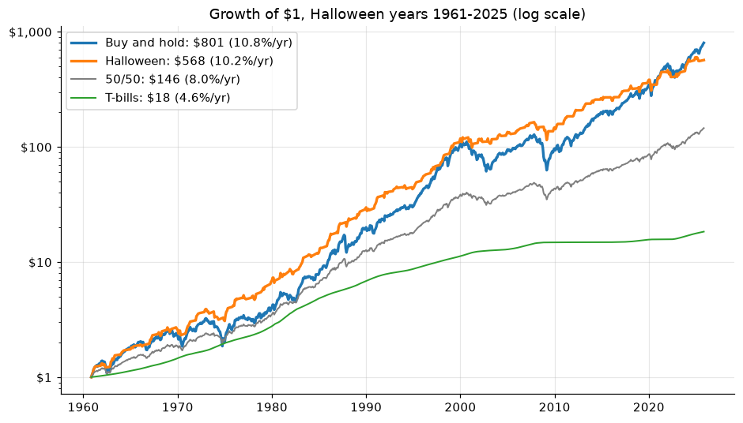
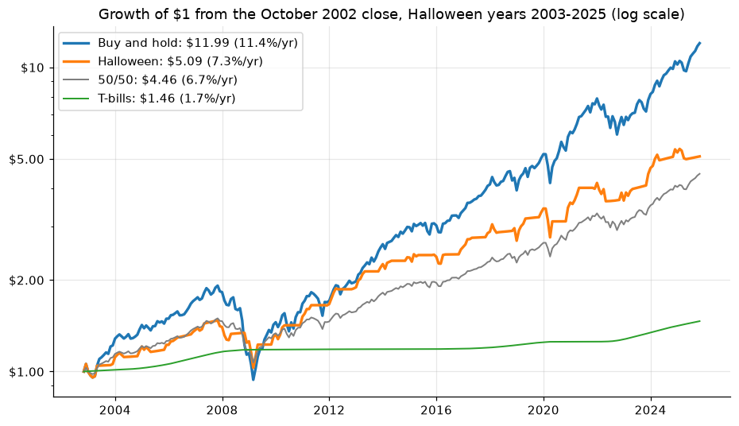
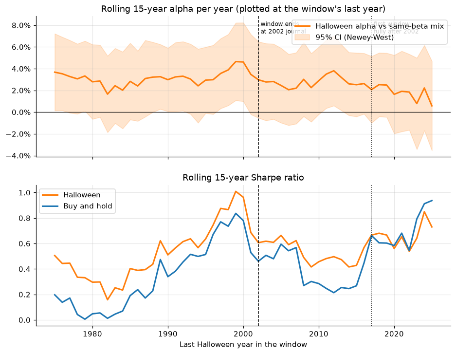

# Sell in May and go away? Testing the Halloween indicator, 1961–2025

This repo has the code and results behind the **"Sell in May"** video on [I'm A Doctor Not A Quant](https://www.youtube.com/@ImADoctorNotAQuant).

**The rule:** hold the S&P 500 from the last close of October to the last close of April, then hold T-bills from May through October. I compared it with buy-and-hold, T-bills alone, a 50/50 stock/T-bill mix, and a stock/T-bill mix with the same market beta. The test covers 65 complete years (1961–2025) and includes dividends and T-bill interest.

## Short answer

The seasonal pattern is real, but trading it hasn't paid, especially since the research was published.

- **Winter beats summer.** November–April stocks averaged +8.3% and May–October stocks +3.3%. The difference was +5.1% a year (95% CI +2.6% to +7.6%), and winter came out ahead in 47 of 65 years.
- **Summer still beat T-bills.** On average, May–October stocks returned 1.0% a year more than T-bills, so selling in May cost money. $1 grew to **$801 with buy-and-hold and $568 with Sell in May**. Sell in May beat buy-and-hold in only 22 of 65 years.
- **It did lower risk.** The worst drawdown was −30% vs −51%, and volatility was 10.3% vs 14.9%. Against a stock/T-bill mix with the same beta, Sell in May earned **+2.5% a year of alpha (Newey–West t = 3.0)**. Its Sharpe ratio was 0.57 vs 0.47, but the 95% CI of that difference includes zero.
- **Since publication, the edge is gone.** Over 2003–2025, buy-and-hold turned $1 into $11.99 and Sell in May into $5.09. Alpha was +0.8% a year (t = 0.5), and Sell in May trailed buy-and-hold by 4.9% a year (95% CI −8.5% to −1.1%).



## Risk-adjusted scorecard

Halloween strategy vs buy-and-hold. Alpha is measured against a stock/T-bill mix with the same market beta (rebalanced monthly).

| Period | Years | Sharpe, Halloween vs buy-and-hold (95% CI of difference) | Beta | Alpha per year (Newey–West t) | Alpha net of 10 bps per switch | Information ratio | Max drawdown |
|---|---|---|---|---|---|---|---|
| Full sample | 1961–2025 | 0.57 vs 0.47 (−0.04 to +0.24) | 0.47 | +2.5% (t = 3.0) | +2.3% (t = 2.8) | 0.34 | −30% vs −51% |
| Through 2002 | 1961–2002 | 0.56 vs 0.34 (+0.06 to +0.37) | 0.46 | +3.4% (t = 3.3) | +3.2% (t = 3.1) | 0.45 | −21% vs −45% |
| After working paper | 1999–2025 | 0.51 vs 0.51 (−0.26 to +0.23) | 0.51 | +1.6% (t = 1.2) | +1.4% (t = 1.0) | 0.20 | −30% vs −51% |
| After journal | 2003–2025 | 0.57 vs 0.70 (−0.46 to +0.17) | 0.51 | +0.8% (t = 0.5) | +0.6% (t = 0.4) | 0.10 | −30% vs −51% |
| Observed ETFs, SPY + BIL | 2008–2025 | 0.56 vs 0.65 (−0.31 to +0.19) | 0.50 | +1.1% (t = 0.6) | +1.0% (t = 0.5) | 0.14 | −30% vs −51% |

Sharpe CIs come from a 3-year block bootstrap over Halloween years. The full table, including Sortino, Calmar, skewness, kurtosis and worst month, is in [`quant_scorecard_long.csv`](results/tables/quant_scorecard_long.csv).

**By decade**, alpha was +4.3% in the 1960s, +3.3% in the 1970s, +2.8% in the 1980s, +3.8% in the 1990s, +1.3% in the 2000s and +4.2% in the 2010s, then −2.6% in 2020–25. Halloween's Sharpe ratio beat buy-and-hold's in 6 of 7 decades. These are short samples, so they show direction, not significance. In the latest rolling 15-year window (2011–2025), alpha was +0.6% a year (95% CI −3.5% to +4.7%).





> **Two measures of the same comparison.** The video's "+2.7 points ahead of a same-risk mix" compares compounded annual returns year by year (`HW_minus_same_beta` in [`risk_by_period.csv`](results/tables/risk_by_period.csv)). The scorecard's +2.5% alpha comes from the monthly regression.

## Other checks

- **Dividends and cash matter.** On price returns with T-bills while out, Sell in May looks like a winner (8.7% vs 7.8% a year). With dividends included, it trails (10.2% vs 10.8%). With dividends included and 0% while out, it falls to 7.8%. See [`variants_dividends_cash.csv`](results/tables/variants_dividends_cash.csv).
- **It's not just the US.** Winter beat summer in all 8 international indices tested, and 6 of them stay significant after a false-discovery-rate correction. The DAX, the only total-return index in the set, has the largest winter-minus-summer gap, +10.4% a year. These are price patterns only, not strategy tests. See [`international.csv`](results/tables/international.csv).
- **It's not just two crashes.** Removing October 1987 and August 1998 (the Maberly & Pierce critique) leaves the seasonal gap at 4.1% per six months (p = 0.004). Removing the 10 largest monthly moves in either half leaves 3.4% (p = 0.016). See [`outliers_monthly_regressions.csv`](results/tables/outliers_monthly_regressions.csv).
- **All 924 six-month calendars.** November–April ranks #14 of 924 by winter-minus-summer premium, but none of the 924 beat buy-and-hold on average. This is a descriptive ranking, not a p-value.
- **St Leger's Day.** The original British saying ends "come on back on St Leger's Day." Coming back at the end of September ended slightly ahead on CAGR (11.0% vs 10.8%), but the year-by-year difference from buy-and-hold is indistinguishable from zero (−0.4%, 95% CI −2.7% to +2.2%).
- **Costs and taxes.** At 10 bps per switch, Halloween's CAGR falls to 10.0%. The breakeven cost is negative, because the rule already trails buy-and-hold before costs. In a stylized taxable account, Halloween returns 7.9% a year vs 10.4% for buy-and-hold ($140 vs $609 per $1).
- **Which cutoff?** Measured after the 1998 working paper, Halloween trailed buy-and-hold by 2.8% a year (CI −6.3% to +1.2%), which is too short a sample to call. Measured after the 2002 journal article, it trailed by 4.9% a year (CI −8.5% to −1.1%). The four years in between (1999–2002) favored Halloween by 9.1% a year on average. See [`cutoff_sensitivity.csv`](results/tables/cutoff_sensitivity.csv).
- **2026 so far** (descriptive, as of the October 13, 2026 close). From the end of April, the S&P 500 total return was +8.9% and modeled T-bills +1.7%.

All 30 tables and 14 charts are listed in [`results/README.md`](results/README.md).

## How it was built

- **Halloween year:** a Halloween year Y runs from November of Y−1 through October of Y, using last-trading-day closes. Only complete months and complete years enter the statistics. The main sample starts in 1961 because Yahoo's T-bill yields start in 1960.
- **Stocks:** S&P 500 total return. This is Yahoo `^SP500TR` from 1988. Before that, it is the `^GSPC` month-end price return plus one-twelfth of Robert Shiller's dividend yield, which is an estimate. Over 1988–2023 the two methods correlate at 0.9999 monthly.
- **Cash:** the Yahoo `^IRX` 13-week T-bill discount yield. The previous month-end quote is converted to one month of carry with the 91-day bill-price formula. This is a modeled return, not a realized one.
- **ETF check:** SPY for stocks and BIL for cash, from adjusted closes (after fund fees), 2008–2025.
- **Primary endpoints:** two tests, both standard in the literature. H1 is the mean annual winter-minus-summer stock return. H2 is the mean annual Halloween-minus-buy-and-hold return. They were fixed in v3 after earlier versions had run, so they are not pre-registered. Everything else is supporting or exploratory.
- **Inference:** confidence intervals use a 3-year circular block bootstrap over Halloween years (10,000 draws, or 2,000 for Sharpe ratios), and also report a sign test. Monthly regressions use Newey–West standard errors (12 lags). Families of tests (months, windows, markets) use Benjamini–Hochberg FDR.
- **Alpha:** monthly Halloween excess return regressed on buy-and-hold excess return (Jensen's alpha), annualized as 12 × the monthly intercept.
- **Robustness:** block length, alternate dividend and cash constructions, a two-month quote lag, winsorizing, dropping the best years, and observed ETF returns. See [`robustness.csv`](results/tables/robustness.csv).

## Reproduce it

```bash
pip install -r requirements.txt
jupyter lab halloween_indicator.ipynb   # then Kernel > Restart & Run All
```

- The notebook downloads its data at run time and writes tables and charts to `halloween_work/outputs_v7/`. The `halloween_work/` folder is git-ignored, so downloaded data never gets committed.
- To get the same sample after October 31, 2026, set `LAST_HALLOWEEN_YEAR = 2025` in the setup cell. Otherwise Halloween year 2026 joins the tables.
- Yahoo revises histories from time to time, so a fresh download can move the last digit of some numbers. The published results came from a run on October 13, 2026 (Python 3.13, pandas 3.0.2, yfinance 1.7.0).
- Self-tests run before any download, and section 5c checks that its numbers match the earlier sections.

## Repository contents

```
├── halloween_indicator.ipynb   analysis notebook (v7), with outputs from the published run
├── requirements.txt
├── results/
│   ├── README.md               index of every table and chart
│   ├── charts/                 14 charts (PNG)
│   └── tables/                 30 summary tables (CSV)
└── LICENSE
```

## Data

**This repo contains no raw market data.** The notebook fetches price and yield histories from Yahoo Finance (through `yfinance`) and dividend data from [Robert Shiller's online data](http://www.econ.yale.edu/~shiller/data.htm). It caches them in `halloween_work/cache/`, which is not tracked. The tables in `results/` hold summary statistics, not price histories or return series. A few individual months or years appear where the analysis singles them out, such as the ten largest monthly moves. Yahoo Finance data are subject to Yahoo's terms, so check the providers' terms before redistributing anything you download. The Ken French cross-check is off by default and is not used in any reported number.

## References

- Bouman, S., & Jacobsen, B. (2002). The Halloween indicator, "Sell in May and go away": Another puzzle. *American Economic Review*, 92(5), 1618–1635. https://doi.org/10.1257/000282802762024683
- Maberly, E. D., & Pierce, R. M. (2004). Stock market efficiency withstands another challenge: Solving the "Sell in May/Buy after Halloween" puzzle. *Econ Journal Watch*, 1(1), 29–46.

## Disclaimer

This is a historical backtest for education. Dividends before 1988 are estimated, T-bill returns are modeled from yields, and the tax scenario is simplified. It is not investment advice.
